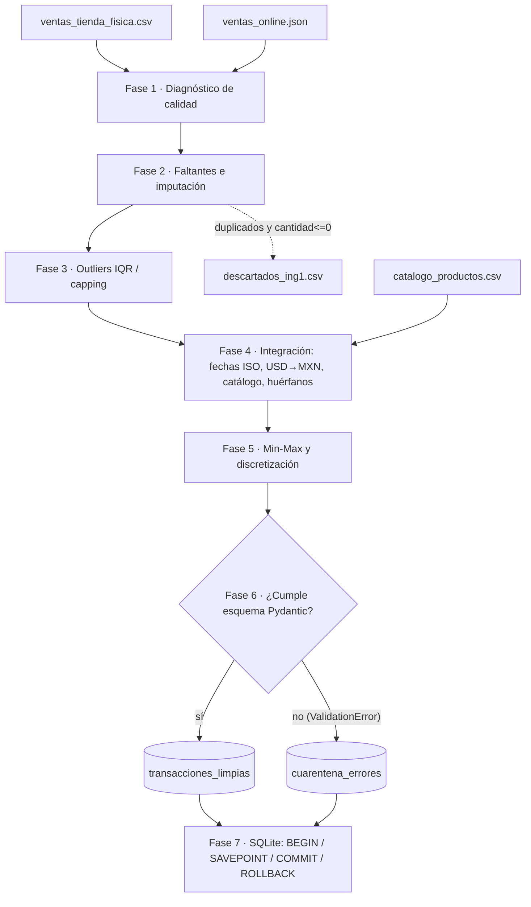

# REGLAS_DE_NEGOCIO.md — Pipeline ETL robusto con cuarentena

**Grupo 1 (LCS2) · Retail & E-commerce omnicanal** · Ingeniería de Datos (ATD-2602) · Unidad 2 · Ago-Dic 2026
Prof. Armando Román Gallardo Heredia

> Las cifras concretas de cada regla (porcentajes, umbrales, conteos) salen del reporte generado por la corrida
> (`salida/Reporte_Proyecto_Integrador_ETL.pdf` y `salida/ing1/reporte_calidad_*.md`). Este documento explica **qué se decidió y por qué**.

## 0. Diagrama de flujo

Ver `docs/diagrama_flujo.png` (también incluido en el reporte PDF). Resumen:

## 1. Principios transversales

| # | Principio | Cómo se cumple |
|---|---|---|
| P1 | **Ningún registro se pierde en silencio** | Lo eliminado va a `descartados_ing1.csv` con motivo; lo inválido a `cuarentena_errores`. La corrida verifica `entrada = descartadas + limpias + cuarentena`. |
| P2 | **Robustez antes que el caso ideal** | Ninguna fase lanza excepciones por datos sucios; una fuente rota no tumba a la otra; la batería `test_estres.py` inyecta 23 tipos de corrupción. |
| P3 | **Trazabilidad auditable** | Cada intervención queda en `flags_ing1`, en la bitácora JSON y en `fila_origen`. |
| P4 | **No inventar llaves ni fechas** | `id_venta`, `id_producto` y `fecha` nunca se imputan. |
| P5 | **Recortar antes que borrar** | Los outliers se recortan (capping), no se eliminan ventas. |

## 2. Fases 1–3 · Calidad, nulos y outliers (Ingeniero/a 1)

Orden: normalizar textos y pseudo-nulos → texto a número → duplicados exactos → valores imposibles → moneda por defecto → recalcular derivados → mediana / etiquetas controladas → capping IQR. Se imputa **antes** de recortar para que el IQR se calcule sobre un conjunto completo, y se recalcula **antes** de usar la mediana porque un dato derivado exacto siempre supera a uno estimado.

| # | Regla | Justificación técnica |
|---|---|---|
| R1 | Textos `N/A`, `-`, `s/d`, `null`, vacío… cuentan como **faltantes** | Un `N/A` convierte una columna numérica en texto y esconde la tasa real de faltantes; el perfilado los cuenta aparte (`pseudo_nulos`). |
| R2 | **Duplicados exactos** (fila idéntica tras normalizar) se eliminan conservando la primera | El POS reenvía registros; contar dos veces una venta infla ingresos. Repeticiones solo de `id_venta` no se borran (podrían ser líneas distintas de un ticket): se reportan. |
| R3 | **Solo se eliminan** filas con `cantidad ≤ 0` | Es el único valor imposible que fija la guía. Precio o monto ≤ 0 se pasan a nulo y se recuperan por R5–R6 (se pierde el dato, no la venta). |
| R4 | Mecanismo de ausencia: MCAR / MAR con indicador de ausencia + Mann-Whitney (numéricas) o χ² (categóricas) + Bonferroni, α = 0.05 | Es lo verificable con los datos. **MNAR no es comprobable** con lo observado; se descarta por conocimiento del dominio. |
| R5 | Si falta `monto_total`, `precio_unitario` o `cantidad` y las otras dos existen → **recalcular** | Identidad contable: sin pérdida ni sesgo. La cantidad solo se deriva si `monto/precio` es ≈ entero. |
| R6 | Faltantes numéricos restantes → **mediana** (precio: por producto+moneda, luego por moneda; cantidad: global) | Las variables son asimétricas a la derecha (el reporte muestra media/mediana y asimetría): bots y compras gigantes jalan la media; la mediana es robusta. Agrupar por producto/moneda evita mezclar USD con MXN. |
| R7 | `id_cliente` y `email` nulos → `ANONIMO`; otras categóricas → `DESCONOCIDO` | Etiqueta controlada: permite segmentar sin inventar identidades. Los correos **malformados** no se corrigen: son violaciones de esquema para Pydantic. |
| R8 | Llaves y `fecha` nunca se imputan | Inventar una llave crearía relaciones falsas con el catálogo. |
| R9 | Outliers con **IQR (factor 1.5) y capping/winsorizing** en `cantidad` y `monto_total` | Límites `[Q1 − 1.5·IQR, Q3 + 1.5·IQR]`; se recorta al límite para conservar la venta (un bot queda como "máximo razonable"). |
| R10 | Límites de `monto_total` **por moneda**; `cantidad` global | Un precio de 15 USD y uno de 300 MXN no son comparables; con un solo IQR los USD parecerían bajos y los MXN altos. |
| R11 | `precio_unitario`: solo se **detectan** outliers | Es un atributo del catálogo: un producto caro no es un error y recortarlo falsearía datos válidos. |
| R12 | Si se recorta `cantidad`, el monto se recalcula; si aún excede su límite se recorta y queda `monto:difiere_qxp` | Mantiene la coherencia contable en casi todas las filas y deja trazadas las excepciones. |
| R13 | Si `monto_total` no coincide con `cantidad × precio_unitario` (> 1 %) y ni cantidad ni precio fueron imputados, el monto se **recalcula** (`monto_total:recalculado_por_incoherencia`) | En los datos oficiales 12 pedidos online traen un total ×80 con unidades normales (bots). La identidad contable es evidencia más fuerte que un total aislado; se hace antes del capping para no recortar un dato que es simplemente erróneo. |
| R14 | Si una fuente no trae `id_cliente` o `email` (la web no tiene cliente; la tienda física no tiene correo), la columna se crea con `ANONIMO` y la bandera `fuente_sin_columna` | Evita rechazar toda una fuente por una columna que no existe; la bandera distingue "no se capturó" de "venía vacío". |
| R15 | `direccion_envio` se perfila (Fase 1) pero **no** se carga a la BD | Dato personal sin uso analítico en este modelo. |

## 3. Fases 4–5 · Integración y transformación (Ingeniero/a 2)

| # | Regla | Justificación técnica |
|---|---|---|
| I1 | Fechas a **YYYY-MM-DD**. Se aceptan ISO (con/sin hora), `AAAA/MM/DD`, **timestamps epoch** (10 dígitos = segundos, 13 = milisegundos) y día/mes/año con `/`, `-` o `.` | Es el estándar pedido y permite ordenar y comparar. El JSON oficial mezcla texto ISO con epoch (`order_timestamp`). El epoch se convierte a hora de Colima (UTC-6, sin horario de verano). |
| I2 | Con separadores, la convención es **DÍA/MES/AÑO** | Formato mexicano de los datos. Las fechas donde día y mes ≤ 12 son ambiguas en teoría; el reporte las cuantifica. |
| I3 | Fecha imposible (31/02, mes 13) o ilegible → nula + bandera `fecha:invalida_a_nulo` | No se inventan fechas; la validación (Fase 6) las envía a cuarentena. Se conserva `fecha_original`. |
| I4 | **USD → MXN a $19.50** en `precio_unitario` y `monto_total` solo si `moneda = USD`; se guarda `moneda_original` | Paridad oficial de la guía. Se convierte **después** de recortar por moneda (R10). |
| I5 | Monedas distintas de MXN/USD no se tocan | Convertirlas sería inventar una tasa; Pydantic las rechaza (`moneda` debe ser MXN). |
| I6 | Catálogo: llave sin espacios y en mayúsculas; llaves nulas se descartan; duplicadas conservan la primera | Garantiza un cruce uno-a-uno (`m:1`) y sin ambigüedades. |
| I7 | **Huérfano** = `id_producto` sin match en el catálogo, o nulo. Se marca (`es_huerfano`), **no se borra** | La guía exige desviarlo a cuarentena; el validador Pydantic lo rechaza con causa explícita. |
| I8 | **Min-Max** de `monto_total` (MXN) en [0, 1]; si max = min, todo queda en 0 | `x' = (x − min)/(max − min)`. Se calcula sobre todo lo integrado antes de validar (orden de la guía). |
| I9 | Discretización en **Bajo / Medio / Alto** con **terciles** del monto en MXN | Cada segmento ≈ 33 % de las ventas; robusto a la asimetría y sin umbrales arbitrarios. Alternativa disponible: `cortes=(a, b)` con reglas de negocio. |
| I10 | `sucursal` (tienda física) y `estatus_pedido` (web) se conservan como atributos; `metodo_pago` unifica método (física) y pasarela (web) en mayúsculas | Permiten segmentar por canal sin perder información. `efectivo` / `Efectivo` / `EFECTIVO` quedan como un solo valor. |
| I11 | Pedidos `CANCELADO` o `DEVUELTO` **no se eliminan** | No son datos inválidos, son transacciones con un estado. Se conservan con `estatus_pedido` para que el análisis decida; quien sume ingresos debe filtrarlos. |

## 4. Fases 6–7 · Validación, cuarentena y base de datos (Ingeniero/a 3)

| # | Regla | Justificación técnica |
|---|---|---|
| V1 | Esquema `VentaLimpia` (Pydantic v2): tipos estrictos, `fecha` ISO, `cantidad` entero 1–10 000, importes finitos > 0, `moneda = MXN`, minmax en [0,1], segmento ∈ {Bajo, Medio, Alto} | Define qué es un registro conforme; la cota 10 000 es de cordura (tras el capping no debería alcanzarse). |
| V2 | `email`: formato válido **o** `ANONIMO` | Coherente con R7: lo imputado es válido; lo malformado se rechaza. |
| V3 | `@model_validator`: `monto_total ≈ cantidad × precio_unitario` (tolerancia 1 %) **salvo** bandera `monto:difiere_qxp` | La discrepancia documentada por el Ing. 1 (recorte IQR / dato origen) no debe duplicarse como error. |
| V4 | `es_huerfano` debe ser falso | Convierte la integridad referencial en una regla del esquema con mensaje claro. |
| V5 | Cada registro se valida de forma independiente en `try/except ValidationError`; el rechazado va a cuarentena con `motivo_rechazo_cuarentena` (campo + causa + valor) y `etapa` | Un registro corrupto jamás detiene el lote. Una red de seguridad adicional captura errores no previstos (`ERROR_INESPERADO`). |
| V6 | Carga en **una transacción** (`BEGIN IMMEDIATE … COMMIT`); `ROLLBACK` completo ante falla catastrófica | La base nunca queda con una carga a medias. |
| V7 | Cada INSERT en su **SAVEPOINT**: si la BD rechaza un registro (CHECK, tipo), solo ese revierte y pasa a cuarentena con etapa `ERROR_BD` | Segunda línea de defensa: la BD también valida, sin detener el lote. |
| V8 | Carga de **reemplazo completo** (idempotente) | Ejecutar el pipeline varias veces no duplica filas. |
| V9 | Todas las sentencias SQL son **parametrizadas** | Texto como `'); DROP TABLE…` se guarda como dato inerte (probado en `test_estres.py`). |
| V10 | Llave sustituta `id_registro` (no se usa `id_venta` como PK) | Un mismo ticket puede tener varias líneas y las fuentes pueden repetir folios. |

## 5. Limitaciones y supuestos declarados

- El IQR con cantidades enteras pequeñas tiene un límite superior bajo y puede recortar compras legítimas; es un compromiso aceptado por la guía (`factor_iqr` es configurable).
- Una moneda nula se asume `MXN`, y la tienda física se asume en MXN si no trae columna de moneda.
- Las fechas con separadores se interpretan como DÍA/MES/AÑO (en los datos oficiales hay 188 con día > 12 y ninguna con mes > 12, lo que respalda la convención). Los epoch se interpretan en UTC-6: es un supuesto con evidencia indirecta (con UTC una fila cae el 17-oct, fuera del rango 01-sep a 16-oct del resto del archivo; con UTC-6 todas caben) y afecta a 49 de los 208 timestamps, que cambiarían de día con UTC. Se ajusta en `config.HORAS_UTC_EPOCH`.
- MNAR no puede verificarse con los datos observados.
- Si el JSON trae una lista de ítems por pedido (varias líneas por orden), esa lista no se expande a filas.

**Firmas del equipo:**

Ingeniero/a 1: ______________________  Ingeniero/a 2: ______________________  Ingeniero/a 3: ______________________

Fecha: ____________
